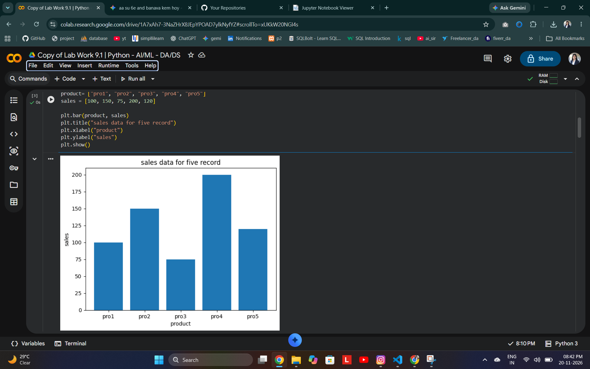
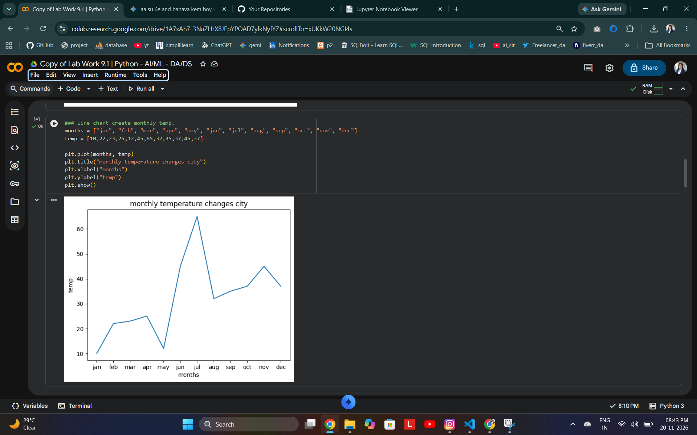
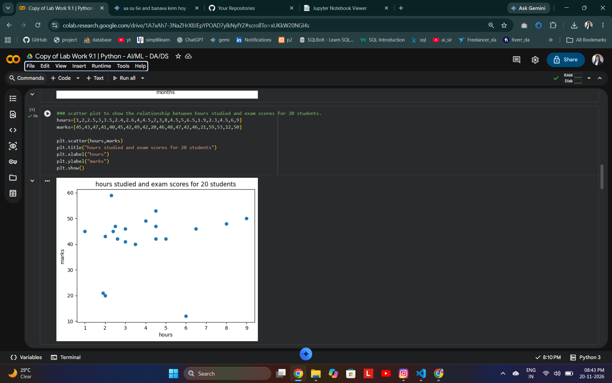
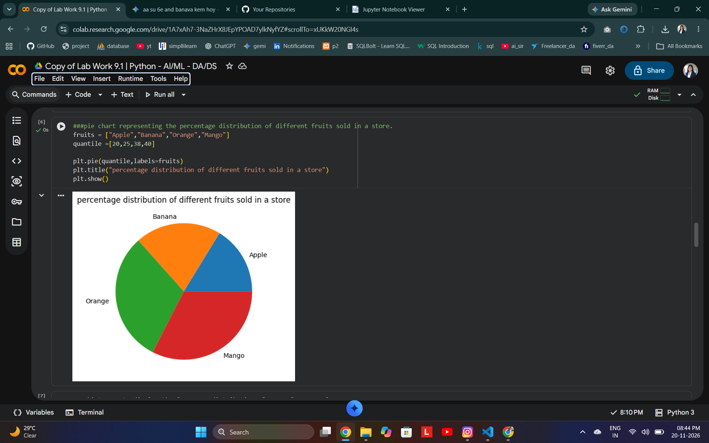
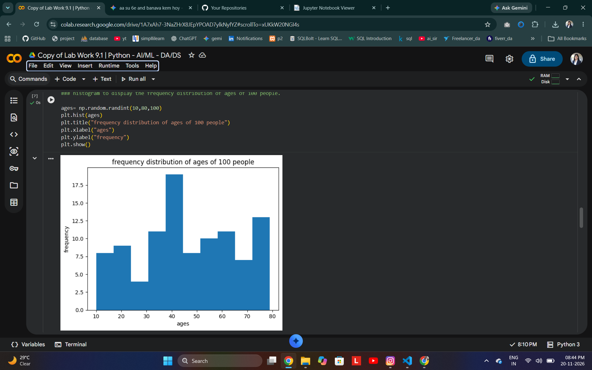
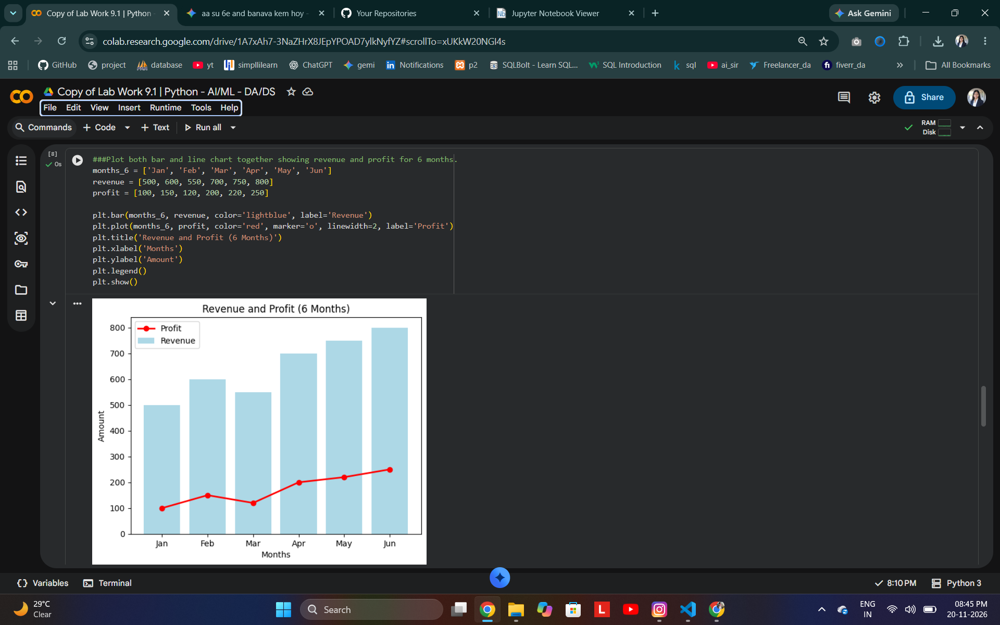
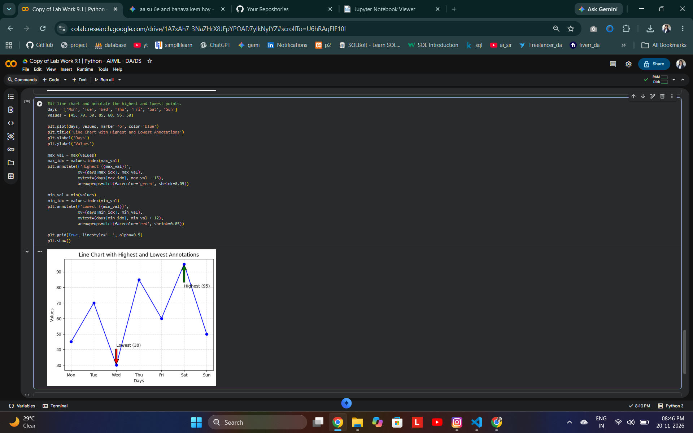
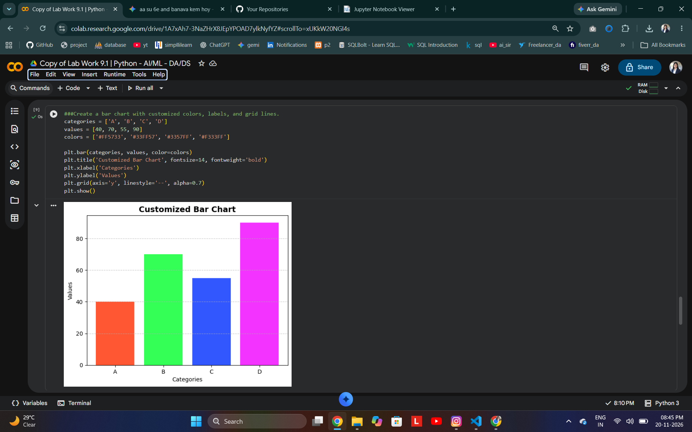

# Matplotlib Data Visualization – Lab Work 9.1

Practical data visualization exercises created in **Google Colab** using **Python** and **Matplotlib** to visualize data across different chart types[cite: 1, 2].

## View Notebook
- **Clean Notebook View (nbviewer):** [Open in nbviewer](https://nbviewer.org/github/jensipethani123-cmyk/matplotlib-charts-labs/blob/main/Copy_of_Lab_Work_9_1___Python_AI_ML_DA_DS.ipynb)[cite: 3, 5]
- **Open in Google Colab:** [cite: 3]

## Charts Created
1. **Bar Chart** – Sales data for five products[cite: 1]
2. **Line Chart** – Monthly temperature changes over 12 months[cite: 1]
3. **Scatter Plot** – Relationship between hours studied and exam scores for 20 students[cite: 1]
4. **Pie Chart** – Percentage distribution of different fruits sold in a store[cite: 1]
5. **Histogram** – Frequency distribution of ages for 100 people[cite: 1]
6. **Combined Chart** – Revenue and profit for 6 months[cite: 1]
7. **Customized Bar Chart** – Custom colors, labels, and grid lines[cite: 1]
8. **Annotated Line Chart** – Highlighting highest and lowest points[cite: 2]

## Chart Screenshots
## Chart Screenshots

### 1. Bar Chart

### 2. Line Chart

### 3. Scatter Plot

### 4. Pie Chart

### 5. Histogram

### 6. Combined Chart

### 7. Customized Bar Chart

### 8. Annotated Line Chart

## Author
**Jensi Pethani**
- GitHub: [jensipethani123-cmyk](https://github.com/jensipethani123-cmyk)
- LinkedIn: [Jensi Pethani](https://www.linkedin.com/in/jensi-pethani-73194a424/)
